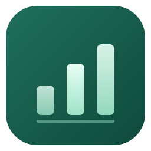
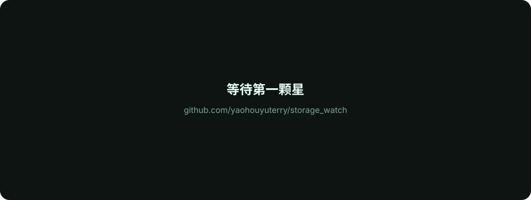

<div align="center">



# Storage Watch

**记录目录占用历史，定位空间增长。**<br>
菜单栏应用，使用 SwiftUI 编写，数据保存在本机。

[](https://github.com/yaohouyu/storage_watch/releases/latest) [](https://github.com/yaohouyu/storage_watch/stargazers) [](LICENSE)<br>
  

**[下载](https://github.com/yaohouyu/storage_watch/releases/latest)** &nbsp;·&nbsp; **[更新日志](https://github.com/yaohouyu/storage_watch/releases)** &nbsp;·&nbsp; **[问题反馈](https://github.com/yaohouyu/storage_watch/issues)** &nbsp;·&nbsp; **简体中文**

</div>

<br>

## 用途

macOS 的「储存空间」会给出各类数据的总量，但不会指出具体是哪个目录发生了变化。

Storage Watch 按固定间隔扫描指定目录，保存每次快照，并比较相邻记录。磁盘空间减少时，可以查看增长最多的目录和变化时间。

- 按增量列出目录，并显示完整路径
- 用 24 小时、7 天或 30 天趋势查看变化
- 与上次记录、当天零点或最近 7 天对比

应用不删除文件，不读取文件内容，也不上传路径。

## 安装

从 **[Releases](https://github.com/yaohouyu/storage_watch/releases/latest)** 下载 `StorageWatch-<版本>.zip`，解压后拖进「应用程序」。

**不需要安装 Python。** 采集引擎的 Python 运行时已经打包在 app 内，首次打开即可用。

> 首次打开若提示"无法验证开发者"，右键 app → 打开，或在终端执行：
> `xattr -dr com.apple.quarantine "/Applications/Storage Watch.app"`

**系统要求**：macOS 13 Ventura 或更高 · Apple Silicon

## 快速开始

**1 · 打开。** 菜单栏出现图标，主窗口自动打开并开始建立第一份基线。首次扫描约几十秒到几分钟，取决于目录规模。

**2 · 等一会儿。** 默认每小时记录一次。想立刻产生第二份数据，点「立即记录」。

**3 · 看变化。** 有了两份以上记录，趋势图和目录排行就会出现。

### 菜单栏

图标旁可以直接显示**可用空间**或**今日变化**，设置里可切换。点开是紧凑面板：

- 磁盘占用胶囊条
- 7 天 sparkline
- 增长最快的 6 个目录，点一下直接在 Finder 显示
- 立即记录 / 打开看板 / 设置 / 退出

## 功能

### 目录变化排行

按变化量排序，展开路径、对比之前/现在的大小，一键在 Finder 中定位。支持按路径搜索，可切换只看增大的目录或看缩小的目录。

### 趋势图

每个点都是一份真实记录，不是插值。休眠或退出期间不会留下虚构数据。图表会自动缩放 Y 轴，几 GB 的波动也看得清。

### 原生设置

监控目录、记录间隔（15 分钟 ~ 12 小时）、保留层级、增长提醒阈值、macOS 通知。

### 自动更新

设置 → 关于与更新 → 检查更新。新版本会在应用内下载、用 SHA-256 校验、验证签名后自动替换并重启。无需回到网页重新下载。

### 隐私

- 只读取文件元数据（`stat`），从不打开文件内容
- 采集引擎只监听 `127.0.0.1`，写操作需要一次性令牌
- 不跟随符号链接，不进入其他挂载卷
- 历史记录保存在 `~/Library/Application Support/StorageWatch/`，退出 app 即停止引擎

## 它是怎么工作的

```text
┌──────────────────────────────────────────┐
│  Storage Watch.app (SwiftUI)             │
│  MenuBarExtra · 主窗口 · 设置 · 更新器     │
└───────────────┬──────────────────────────┘
                │ 本机回环 HTTP + 一次性令牌
┌───────────────▼──────────────────────────┐
│  engine/monitor.py                       │
│  扫描 → SQLite 历史 → 变化比较 → 定时器     │
│  随 app 启动，随 app 退出                   │
└──────────────────────────────────────────┘
```

Swift 只负责界面，扫描留在 Python 标准库里——这部分经过 18 个测试覆盖。Python 运行时随 app 打包，用户侧零依赖。

## 统计口径

- 目录大小按 `st_blocks × 512` 估算已分配块，不解析 APFS 克隆与共享块
- 硬链接只计一次；不跟随符号链接；不跨挂载卷
- 目录不可读时标记为"不完整"，不会把权限变化误判为删除或增长
- 父目录包含子目录，排行中的父子变化不可相加
- 磁盘可用空间来自系统统计，与目录总量不强行对齐
- 最近 7 天保留每次记录，之后每日一份，共 30 天

## 开发

```bash
git clone https://github.com/yaohouyu/storage_watch.git
cd storage_watch

# 运行引擎测试
python3 -m unittest discover -s tests -v

# 构建 app（首次会下载并缓存内嵌 Python）
cd app && ./build-app.sh
open "build/Storage Watch.app"
```

构建只需要 Xcode Command Line Tools。`build-app.sh --no-python` 会跳过内嵌运行时，使用本机 Python（仅开发用）。

### 项目结构

```text
app/                        SwiftUI app（Swift Package，无需 Xcode 工程）
  Sources/StorageWatch/
    StorageWatchApp.swift   MenuBarExtra 入口与应用生命周期
    WindowController.swift  主窗口的创建与复用
    Engine.swift            拉起内嵌 Python 引擎、回环 API 客户端
    Store.swift             轮询与派生数据
    MainWindowView.swift    指标卡 / 趋势图 / 变化表 / 工具
    MenuPanelView.swift     菜单栏下拉面板
    SettingsView.swift      设置与更新
    UpdateChecker.swift     GitHub Releases 下载、校验、替换、重启
    Plugins.swift           功能模块注册表
  build-app.sh              打包脚本（含内嵌 Python 运行时）
engine/monitor.py           扫描、SQLite、历史比较、定时器、HTTP API
tests/                      18 个关键行为测试
scripts/make_star_chart.py  生成 site/assets/stars.svg
```

### 扩展新功能

`Plugins.swift` 里的 `FeaturePlugin` 协议预留了功能模块位。新增一个模块：

1. 实现 `FeaturePlugin`，在 `makeView()` 里返回界面
2. 注册进 `PluginRegistry.all`
3. 需要新数据时，在 `engine/monitor.py` 加 `/api/...` 端点，Swift 侧用 `Engine.get/post`

缓存清理、大文件速览已经作为占位模块出现在界面里。

## 发布新版本

```bash
# 1. 改版本号
#    app/Resources/Info.plist -> CFBundleShortVersionString / CFBundleVersion

# 2. 构建并打包
cd app && ./build-app.sh
cd .. && ditto -c -k --keepParent "app/build/Storage Watch.app" "build/StorageWatch-1.1.0.zip"
shasum -a 256 "build/StorageWatch-1.1.0.zip" | cut -d' ' -f1 > "build/StorageWatch-1.1.0.zip.sha256"
cp "build/StorageWatch-1.1.0.zip" "build/StorageWatch-1.1.0.zip.sha256" /tmp/

# 3. 发布（需要 gh CLI 或网页操作）
gh release create v1.1.0 "/tmp/StorageWatch-1.1.0.zip" "/tmp/StorageWatch-1.1.0.zip.sha256" --generate-notes
```

应用内的更新器会读取最新 release，比对版本号，然后下载、校验哈希、验证签名、替换并重启。

## Star 历史

<a href="https://github.com/yaohouyu/storage_watch/stargazers">
  
</a>

<br>

如果它帮你找到了那个"偷偷变大的目录"，欢迎点个 ⭐。

## License

[MIT](LICENSE)
